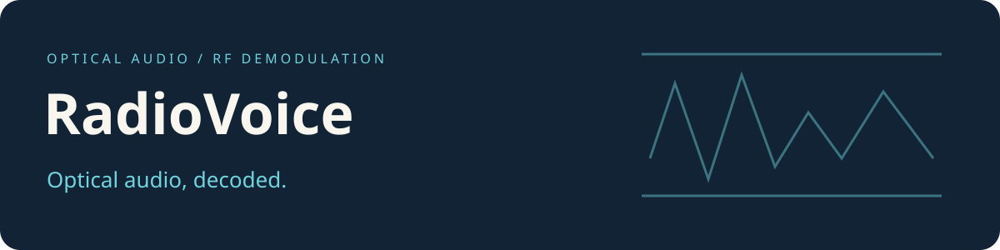

# RadioVoice

GNU Radio flowgraphs for RF-modulated optical audio and recorded-signal demodulation.

RadioVoice organizes the flowgraphs with setup documentation and an offline preservation record.

## Choose a flowgraph

- **`laser_mf_demod.grc`** → `laser_mf_demod.py`: reads a live `osmosdr`
  source, translates and AM-demodulates the signal, and writes `/tmp/sdr.wav`.
- **`laser_zmod.grc`** → `laser_zmod.py`: reads a live `osmosdr` source,
  translates it, takes a real-valued channel and sends it to an audio sink.
  This graph has no WAV writer.
- **`saleae_demod.grc`** → `saleae_demod.py`: reads a float sample file from
  the original author's absolute path, then provides audio playback and
  `/tmp/sdr.wav` output. The input file is not included here.
- **`usrp_laser_demod2.grc`** → `usrp_laser_demod2.py`: reads a live UHD/USRP
  source, translates and AM-demodulates it, then provides audio playback and
  `/tmp/sdr.wav` output.

These are generated GNU Radio applications. Open each `.grc` file in GNU Radio
Companion to inspect and adapt its source, sample rate and output path before
running it. In particular, three graphs target the same `/tmp/sdr.wav` file;
the supplied configuration can replace an existing file there. No captured
signal or recovered-audio example is bundled.

## Environment

The generated files target GNU Radio 3.10.10.0 and use Qt. Individual graphs also import SDR-specific modules such as `osmosdr`. Hardware sources need compatible devices and drivers; recorded-data sources need their expected input files. This repository does not bundle a runnable Python environment.

[Preservation and verification](COMPATIBILITY.md) records the offline checks and their limits.

## Source terms

Based on [rflasermic](https://github.com/samyk/rflasermic/tree/7599f00a57b88cfcf8370cf88db6c04fa4e3da06) by **Samy Kamkar**. [Source and contribution details](NOTICE.md).

New repository presentation and documentation are under [MIT](LICENSE-MIT). The generated Python flowgraphs retain their existing [GPL-3.0 terms](LICENSE-GPL-3.0) and SPDX notices. GNU Radio and device modules retain their separate terms.
